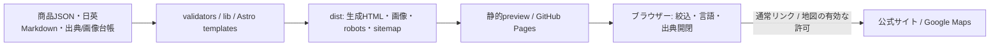

# 構成とデータの流れ

対象は公開版0.17.0・産地地図/地図表示設定019、文書の入口は保守改訂017を継承。確認日2026-11-17。

0.17.0（仕様019）は公開・実URL確認済みです。app `b8edee4e26c92a9a62c9133bf432aecc4666199a`、[Actions44051153186](https://github.com/rozawa619/japanese-craft-jewelry/actions/runs/44051153186) completed/success（2026-11-17T08:58:25Z更新、08:58:40.558ZにAPI観測）。公開Source328HTML SHA・補足24（328正規URL/118画像SHA）・日本地図193・表示設定22・mobile92が成功しました。詳細と最新納品状態はdeployment-resultsを正本にします。

このサイトは、日本各地の工芸ジュエリーを日英で紹介するAstroの静的サイトです。商品や価格をファイルで編集し、検証してHTMLを生成します。公開先にNodeのアプリサーバー、DB、管理画面、注文・決済APIはありません。Nodeは開発・検証・静的生成のために使います。

この文書は「どこを直し、何を別管理のまま保つか」を説明します。起動は[setup](setup.md)、実際の変更は[編集手順](editing-guide.md)、確認の組合せは[検証手順](verification-guide.md)、AIへの引継ぎは[ai-handoff](ai-handoff.md)を参照してください。現在の公開commit・件数・検証結果は[deployment-results.json](deployment-results.json)と[verification](verification.md)が正本です。文中の構成説明を公開成功や提携承認の証拠にしません。

## 全体像



buildは商品の最新在庫を外部サイトから取得しません。購入根拠の論理的な整合を検査し、保存済みの事実・確認日を表示します。現行の商品/店舗情報は、更新担当が一次情報を読んでから正本へ反映します。

```text
src/
  data/              商品・翻訳・紹介・広告・根拠・画像の正本
  content/           日英Markdownの本文、産地/工芸/方針
  config/            公開URL/base、編集順、産地の表示設定
  lib/               データの読込/検証、表示用導出、URL/市場/広告のgate
  components/        共通の表示部品と、その部品の小さなブラウザーJS
  layouts/Base.astro 共通head、nav/footer、SEO、広告offの確認
  pages/             AstroのURL入口とgetStaticPaths
  styles/            共通CSS（部品内のscoped styleもある）
public/              そのまま配信する画像・favicon等
docs/research/       一次出典・確認記録。一部JSONはbuildの入力
docs/assets.json     画像の権利/用途/退役台帳。buildの入力
scripts/             検証、外部URL確認、画像確認、書出し
tests/               Node unit tests
specs/               仕様・設計・タスク・検証の対応
.github/             検証とPages配信のworkflow、更新通知設定
```

## 正本と、そこから作るもの

| 情報 | 編集する正本 | 読込・導出・表示 |
| --- | --- | --- |
| 商品ID/slug、素材、産地、工房、金具、価格、リンク、広告program | `src/data/catalog.json` | `schema.ts`で形式検証、`catalog.ts`で読込。`ProductCard`・商品template等へ |
| 日本語の商品名・説明・寸法等の表現 | `src/data/translations/ja.json` | `catalogFor('ja')`が日本語表示用のviewを作る |
| 商品ページの見出し・要点・装い・選ぶ条件 | `product-stories.json` | `product-stories.ts`、`SelectionDecision`、商品template |
| 商品を深める本文 | `src/content/products/`と`ja/` | `productNotes` collectionをproductId/localeで対応させる |
| 公開候補どうしの違い | `selection-notes.json` | `selection-notes.ts`、`ChoiceDetails` |
| 各商品の質問3問×日英 | `product-buying-guides.json` | `product-buying-guides.ts`、`ProductBuyingGuide` |
| 国内通販/小売＋カタログの購入根拠 | `purchase-evidence.json` | `purchase-evidence.ts`、`PurchaseEvidence`、validator |
| 店舗、商品との対応、公式home、訪問の注意 | `visits.json` | `visits.ts`、`VisitGuide` |
| 出典URL・タイトル・実確認日・閲覧状態 | `docs/research/sources.json` | `catalog.ts`が直接importし、`Sources`が表示する |
| 人物AIイメージ / 単体AIイメージ | `editorial-images.json` / `product-detail-images.json` | 各画像helper、`EditorialImage` / `ProductDetailImage` / `TypeChoiceImage` |
| 画像bytes・alt・用途/退役の根拠 | `public/images/`、`docs/assets.json`、生成記録JSON | image validator、WebP/XMP/SHA確認、退役ファイルの除外 |
| 編集順、観光訪問率の表示、産地の代表 | `config/selection.ts`、`config/region-selection.ts`、`region-choice-notes.json` | `RegionSelection`、`RegionalChoiceGuide`、`type-choices.ts` |
| Google地図の取得済み埋込みURL | `lib/store-map-embeds.ts` | `map-embed-url.ts`が許可URLを判定し`VisitGuide`へ |
| 日本地図/3県 | data/japan-map-geometry.json・config/japan-map.ts | CC0の47県path、JapanJewelryMapが公開商品/地域本文から選択県/代表を導出 |
| 地図の30日設定 | lib/map-preferences.ts・map-preferences-client.ts | 最小Storageと版/期限の検証、全iframe表示/停止、MapPreferencesの状態を共通化 |
| Google広告の現在状態 | `advertising-privacy.json` | `advertising-privacy.ts`の固定off schema、`AdvertisingPrivacyStatus`、`Base` |

表で`src/data/`を省略したJSONは同ディレクトリにあります。本文やQ&Aへ価格・販売URLを複製すると更新先が二つになります。Q&Aの`{size}`・`{findings}`・`{fastening}`は、表示する言語のcatalog値から展開します。不明な値でtokenを埋めたり、AI画像から仕様を補ったりしません。

`docs/`は全部が任意の説明資料というわけではありません。出典JSON、画像台帳、画像生成記録などをコードとvalidatorが読みます。fresh cloneやソースZIPから起動する場合も、同梱docsを保持します。一方、`dist/`・`.astro/`・`node_modules/`は再生成/再取得する派生物です。`artifacts/`は私的な検証ログ・画面等で、公開アプリや通常buildの入力ではありません。外部のPNG原本アーカイブも通常のbuildには不要です。

### 0.16の画像生成ログを増やす方法

人物の新規10点は[image-generation-v16.json](image-generation-v16.json)、単体の新規10点は[image-generation-solo-v16.json](image-generation-solo-v16.json)へ分離しました。旧98画像と旧生成ログは変更せず、新規23PNGの採用20・棄却3を各ログの`images`/`rejectedCandidates`へ記録しています。人物と単体の対応表・権利台帳・採否記録は別の役割です。

単体検査は[scripts/lib/image-generation-manifests.mjs](../scripts/lib/image-generation-manifests.mjs)の`loadSoloGenerationManifests`が旧v14と新v16の単体ログを併読します。商品IDの重複や不正なpath/hashを拒否し、`check-product-detail-images.mjs`が合算した記録をactive registry全60商品、実ファイル、distのbytesへ照合します。v16ログは後方互換のためreader上はoptionalですが、新画像をactive registryへ登録した状態では、欠落すると全件一致が失敗します。人物のv16ログをこの単体readerが読むわけではありません。

次の追加でも旧ログを新画像の内容へ書き換えず、別の版のmanifestとreaderの参照先を追加します。例の件数を合格条件として固定せず、実際の公開商品集合から全件対応を確認します。

## ページができるまで

1. `content.config.ts`がMarkdown collectionsの形式を定義し、`contentFor`が公開状態と言語で絞ります。商品・店舗・選択・画像等の横断参照は`validate.ts`などが別に検査します。
2. `catalog.ts`が共有catalogを読み、日本語表示のviewを作ります。`productsFor(locale)`は公開商品を編集順に並べます。viewや並び順は正本を書き換えません。
3. `pages/[lang]/objects/[slug].astro`等の`getStaticPaths`が実際に公開するURLを列挙します。商品本文・画像・購入根拠・Q&A・出典を、同じ安定productIdで組み合わせます。
4. `Base.astro`が共通のheadとnav/footerを描画します。canonical・hreflang・検索説明・パンくずは`seo.ts`、JSON-LDの安全な文字列化は`structured-data.ts`へ集約しています。
5. Astroが`dist/`を作り、retired imageの除外と生成物検査を行います。`dist`のHTMLを直接修正しても次のbuildで消えるため、正本へ戻って変更します。

ルート`/`は言語を選ぶ入口です。JSは推奨言語を先頭へ並べるだけで強制転送しません。`/en/`と`/ja/`に同じ構造のページを持ち、`LanguageSwitch`が現在ページのquery/hashを引き継ぎます。都道府県・工芸・工房は実際の公開商品/本文に対応する集合を使います。将来の全国展開のために、未調査の空ページを大量生成しません。旧journalは`legacy-routes.ts`と`LegacyRedirect`の固定移動口で、現行ブログではありません。

## 表示言語・価格市場・広告は三つの判断

`locale='en'`は英語表示であり、USDへの換算や海外向けストアへの自動切替ではありません。

`marketPricesFor`は共有catalogの`localizedPrices.ja`を国内JPYの優先値とし、それがなければJPYの原値を使います。外貨の原値は別の`international`枠です。どちらも確認済みの実価格で、FX計算・店頭価格推定・差額の送料換算は行いません。`catalogFor('ja')`には表示互換の価格overlayがありますが、市場を判断する時は`p.priceAmount`だけで決めず`marketPricesFor(productId)`を使います。

`MarketPrice`はその市場の値を`Intl.NumberFormat`で表記するだけです。`MarketPurchaseLink`は同じ市場のリンク集合を選び、UI言語に合うリンクIDだけを`RetailerLink`へ渡します。言語に合わない別市場リンクの承認を借りず、その場合は確認済みの通常公式リンクを出します。

`resolveRetailerLink`は最後の広告判定です。linkとprogramの両承認、programId、対象merchantへの所属、実在する確認日、完全一致の許可hostが揃った時だけ広告URLと`sponsored`を返します。欠落・停止・不正な広告URLは安全な公式URLへ戻り、公式URLも使えなければボタンを出しません。`Disclosure`は実際に表示するmarket/link IDsに対応します。`VisitGuide`等の明示的な公式情報リンクは、別のCTAが広告になっても通常リンクのままです。

このアフィリエイトリンクの仕組みと、Google AdSense配信は別です。現行のGoogle広告はoff固定で、環境flagだけでは開始できません。Maps表示のボタンも広告同意や認定CMPではありません。

## ブラウザーが担当する小さな処理

| 処理 | 担当 | 保つ動作 |
| --- | --- | --- |
| 一覧の絞込・価格順 | `pages/[lang]/objects/index.astro`、`shopping-filters.ts` | 公開商品だけを対象にqueryを更新。無効値を無視し、clear/back/言語往復を確認 |
| 言語入口と切替 | `pages/index.astro`、`LanguageSwitch` | 強制翻訳/転送をせず、同ページ/query/hashへ |
| 出典リンクと開閉 | `Sources.astro` | native detailsとanchorを維持し、明示リンクを一度だけ処理 |
| 下部の購入CTA | 商品templateのscript | 主CTAやfooterの位置・狭幅に応じて表示。購入市場は共通部品に任せる |
| 地図の表示/全停止 | map-preferences-client.ts・VisitGuide・MapPreferences | 初回許可後30日自動表示。未選択/拒否/期限切れではiframeなし、全撤回/旧版/不正/保存不可も確認 |
| 全国地図のpreview | JapanJewelryMap.astro | hover/focus/tap/select、代表単体画像/価格、地方一覧とJSなしの通常リンク |
| 横スクロール表等の補助 | `Base.astro`の共通script | 画面/キーボードの操作を補助。商品事実を再計算しない |

通常の紹介・公式リンク・native detailsはJSなしでも使えます。JSなしの絞込や地図表示には制約があるため、各ページの説明と通常リンクを残します。

### 出典anchorの競合を戻さない

`Sources.astro`だけが同ページの出典anchorを扱います。通常の左クリック/Enterで、対象が出典details内にある時だけnative hash遷移を止め、`history.pushState`でfragmentを更新し、開く・scroll・summary focusを一度行います。modifier key、中クリック、別target、download等は横取りしません。初回の直接hashと履歴によるhashchangeでは対象を開きますが、強制focusはしません。

以前は商品template側のopen handlerと後着のhashchangeが重なり、すぐに閉じた出典が再度開く競合がありました。商品側に同じhandlerを追加したり、明示クリックでnative hashchangeを再び発火させたりしないでください。確認入口は`check-source-anchor-race.mjs`です。DOMの形式だけでなくrapid close、focus/Tab、history、直接hash、JSなしも確認します。

### 地図と外部接続

地図URLはGoogle Shareから確認したregistryだけを使います。reviewedMapEmbedUrlがHTTPS・www.google.com・/maps/embed・単一pbを制限します。Googleマップは初回の明示許可後、日英・全店舗で30日間自動表示します。未選択/拒否/期限切れではGoogle通信0、オフ操作で全iframeを停止。localStorageには地図専用choice/version/savedAt/expiresAtだけを保存し、不正/旧版の値は削除し、有効期限30日を過ぎた値は次の読込/再表示時に削除します。保存不可はページ限りです。複数タブ/戻る/再訪でも撤回を尊重します。PC330px/スマホ280pxの枠高を基本に、Google帰属・fullscreen・公式/外部リンクを保ちます。地図設定版maps-v17と広告Privacy版v14は別で、地図設定は広告同意/CMPではありません。

設定keyはjcj.map-choice.v1、設定版は2026-11-17-maps-v17です。Googleへ受信済みの情報やCookieを当サイトが消すことはできません。旧方式は[0.14 Maps記録](inline-maps-v14.md)に履歴として保持します。

## 全国地図と現在の入口

産地の共通入口はTOP10→日本地図→DISCOVER3県。観光TOP10順位は維持し、47県のCC0形状から実商品/産地本文のある掲載24県だけを選択可能にします。代表単体AI画像・商品名・国内参考価格を正本から表示し、select・地方別一覧・地図ジャンプも用意します。hoverだけに頼らず、タップ/keyboard/JSなしの通常リンクを保ちます。

日本地図はsrc/data/japan-map-geometry.json（CC0出典/47県形状）、src/config/japan-map.ts（地方とDISCOVER3県）、JapanJewelryMap.astro（代表preview）。店舗の地図はmap-preferences.ts（30日/版/最小値検証）、map-preferences-client.ts（全表示/全停止）、MapPreferences.astro（Privacyの設定UI）へ分離します。外部JS/タイル/API/現在地/Storageは全国SVG地図では使いません。店舗Googleマップは別機能です。[日本地図](japan-map-v17.md)・[残タスク](remaining-task-audit-v17.md)・[法務再確認](legal-review-v17.md)・[商用ホスト移行準備](commercial-host-migration-v17.md)を参照してください。今回は新bitmap生成なし。

## 検証・CSP・配信

`pnpm verify`は型/データ参照→unit→静的生成→生成リンク/CSP→人物/単体画像/Privacyの検査です。Chrome操作や最新在庫確認は含みません。`pnpm dev`で見えることだけでも、公開validator全体を通したことにはなりません。ブラウザー検査は安定した最終`dist`のpreviewを見て行い、同じ`dist`を別作業がbuildしている間は実行しません。

`scripts/check-runtime.mjs`はpackage.jsonのNode最低版を読みます。`scripts/astro.mjs`は起動前に検査し、同じNode実行ファイルでAstroを起動します。CIも最低版を確認してから固定pnpm/lockfileでinstallし、依存audit・readiness・verify・SEOを通してPagesへ渡します。特定のPCの`artifacts/runtime/`は開発時の補助で、fresh cloneの起動依存ではありません。Nodeと、pnpm自身/子プロセスが使うruntimeを[setup](setup.md)で確認します。

`astro.config.mjs`はHTMLのhashベースCSPを生成します。現行buildでは、一つのscoped CSSや共通scriptの変更でも、全ページのCSP hash一覧が変わることがあります。変更HTML数を見て影響を推定せず、CSP・実CSS/JS・本文を分けて調べます。実例は[見出し差分](visual-mobile-stage-heading-build-delta.json)と[出典操作差分](visual-mobile-stage-source-nav-build-delta.json)です。

実行scriptはself/hash、外部connectはnone、iframeはGoogleの固定origin等に制限しています。JSON-LDには`serializeJsonLd`を使い、HTMLの終了タグを混ぜないようにします。これは安全性の保証ではありません。meta CSPで設定できないframe-ancestors等に対するpublic/_headersを同梱しますが、Cloudflare Pages等の対応ホスト向け移行準備です。GitHub PagesのHTTP header設定にはならず、現host/accountの未完了を解消済みにしません。[移行手順](commercial-host-migration-v17.md)と[security review](security-review-v15.md)を参照してください。

外部URLの到達性確認は別の運用ツールです。`check-external.mjs`→Node専用`safe-outbound.ts`で各redirect/全DNSの公開IPを確認し、接続IPを固定してTLS接続します。ブラウザー用の一般fetch helperへ流用しません。HTTP成功だけでは商品仕様、在庫、権利、提携資格は確認できません。

生成物は`dist`、正確な公開結果はActionsと公開後report、ソース/ZIPの集合とbytesは納品proofで確認します。これらの成功は別々の出来事です。詳細な起動・更新・検証・書出しの操作は、それぞれのrunbookを参照してください。
